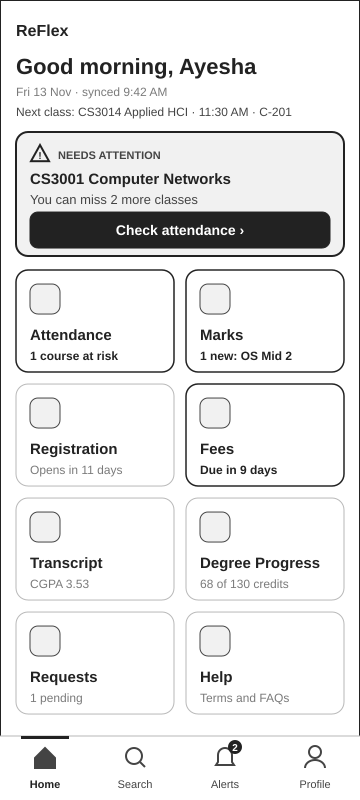
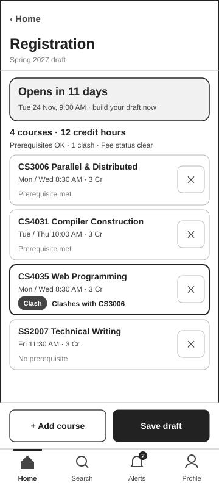

# Phase 3 · Sketching and Low-Fidelity Wireframes

Phase 3 develops the core task flows from sketches into greyscale wireframes. The SVG exports in
`docs/assets/wireframes/` can be viewed in the repository or imported into Figma.

Bilal Rauf sketched in Figma with a drawing tablet. M. Hassaan and M. Zain Tahir sketched on paper.
The team refined the concept with Claude with the instructor's permission.

- [ReFlex P3 sketches](https://www.figma.com/board/Nmvs2wOegbnKaS8D5x95K9/ReFlex_P3_sketches?node-id=0-1&t=u9Nl93muI9cgppAX-1)
- [ReFlex P3 wireframes](https://www.figma.com/design/e6HMDdaUUIJ1b5Xwf6CuVA/ReFlex_P3_wireframes?node-id=1669-162202&t=ttLVdqiT5KHjZRDP-1) (view-only, source of truth)

---

## Launchpad Home and navigation

Home (Screen 4) places one **Needs attention** card above 8 tiles: Attendance, Marks, Registration,
Fees, Transcript, Degree Progress, Requests and Help. Each tile shows a live status line, and the
whole tile acts as the button. The tiles replace the switcher that grouped Attendance, Marks and
Transcript on mobile.

The bottom bar has **Home, Search, Alerts and Profile**. Alerts opens Notifications (Screen 17).
Profile covers Profile and Privacy Controls (Screen 19) and Settings (Screen 20). See
[ADR 0005](../decisions/0005-launchpad-home-and-four-item-bar.md).

The design is mobile-first. Desktop wireframes cover Home (Screen 4) and Attendance Detail
(Screen 6).

## Touch rules

- Tap targets are at least 44 px, with most sized from 48 to 52 px and 8 px between targets.
- The whole tile, row or card is tappable. Every action is available by tap without swiping or hovering.
- Main actions are pinned above the bottom bar.

---

## Core tasks

| Task | What the user is trying to do | Persona | Story | Taps from Home |
| :---: | :--- | :---: | :---: | :---: |
| **T1** | Check how many more Computer Networks classes I can miss | Ayesha | US-01 | 1 (or 2 via the Attendance tile) |
| **T2** | Find the score I need in my Operating Systems final to reach a total of 70 | Ayesha | US-02 | 3 |
| **T3** | Plan a clash-free draft schedule before registration opens | Hamza | US-05 | 4 |

Two of the three tasks belong to Ayesha because she is the persona with the most constraints:
phone-first, unreliable connectivity, plain language and an optional Urdu/English toggle.

---

## Screens drawn

Screen numbers are the stable IDs from [`docs/screens/README.md`](../screens/README.md). Empty,
loading and error views share the screen's ID.

| # | Screen | Used in | Wireframe |
| :---: | :--- | :---: | :--- |
| 3 | Login | Entry | [s-03-login.svg](../assets/wireframes/s-03-login.svg) |
| 4 | Today / Dashboard | T1, T2, T3 | [mobile](../assets/wireframes/s-04-home.svg) · [desktop](../assets/wireframes/d-04-home-desktop.svg) |
| 5 | Attendance List | T1 | [s-05-attendance-list.svg](../assets/wireframes/s-05-attendance-list.svg) |
| 6 | Attendance Detail | T1 | [mobile](../assets/wireframes/s-06-attendance-detail.svg) · [desktop](../assets/wireframes/d-06-attendance-detail-desktop.svg) |
| 7 | Marks List | T2 | [s-07-marks-list.svg](../assets/wireframes/s-07-marks-list.svg) |
| 8 | Marks Detail and Grade Projection | T2 | [s-08-marks-projection.svg](../assets/wireframes/s-08-marks-projection.svg) |
| 11 | Registration Planner | T3 | [mobile](../assets/wireframes/s-11-registration-planner.svg) |
| 12 | Course Search | T3 | [s-12-course-search.svg](../assets/wireframes/s-12-course-search.svg) |
| 13 | Finance Timeline | T3 (fee hold) | [s-13-finance-timeline.svg](../assets/wireframes/s-13-finance-timeline.svg) |
| 18 | Notification Settings | T1 | [s-18-notification-settings.svg](../assets/wireframes/s-18-notification-settings.svg) |
| 21 | Help and Glossary | T2 | [s-21-help-glossary.svg](../assets/wireframes/s-21-help-glossary.svg) |

---

## Boards

The board exports are in `docs/assets/wireframes/boards/`.

| Board | Files |
| :--- | :--- |
| **User flows**, every decision, empty and error path, ending in success | [T1](../assets/wireframes/boards/user-flow-t1.svg) · [T2](../assets/wireframes/boards/user-flow-t2.svg) · [T3](../assets/wireframes/boards/user-flow-t3.svg) |
| **Linked flows**, screens joined by what the user taps, with back paths dashed | [T1](../assets/wireframes/boards/linked-flow-t1.svg) · [T2](../assets/wireframes/boards/linked-flow-t2.svg) · [T3](../assets/wireframes/boards/linked-flow-t3.svg) |
| **Annotations**, numbered sticky notes with open questions in pink | [T1](../assets/wireframes/boards/annotations-t1.svg) · [T2](../assets/wireframes/boards/annotations-t2.svg) · [T3](../assets/wireframes/boards/annotations-t3.svg) |
| **States**, ideal, empty, loading and error | [Screen 6](../assets/wireframes/boards/states-s-06.svg) · [Screen 8](../assets/wireframes/boards/states-s-08.svg) · [Screen 11](../assets/wireframes/boards/states-s-11.svg) |

---

## Attendance Detail and Marks

**Attendance Detail (Screen 6)** leads with one large answer, **“You can miss 2”**, above a bar
marked at 80%. The class-by-class grid uses ticks and crosses for the 36 classes held, including
7 absences. **Set alert** and **Full log** are pinned above the bottom bar. The figures follow
`calculateHeadroom()`. The wireframe shows 29 classes attended, 12 remaining and 39 required to
meet the threshold, so headroom is **29 + 12 - 39 = 2**.

**Marks (Screen 8)** updates the projection as soon as the student taps a target total of **60**,
**70**, **80** or **Other**. The example result reads **“You need 33 of 50 in the Final”**.
See [ADR 0004](../decisions/0004-target-total-not-letter-grade.md).

---

## Open questions from the annotations

To settle in Phase 4 or with users in Phase 5.

- Should Attendance List sort by risk or by course code?
- Should Settings stay under Profile or have its own tile?
- Should Marks rows show the class average?
- Should Registration Planner suggest another section when it detects a clash?
- Should the planner allow a clashing course with a warning or block it?
